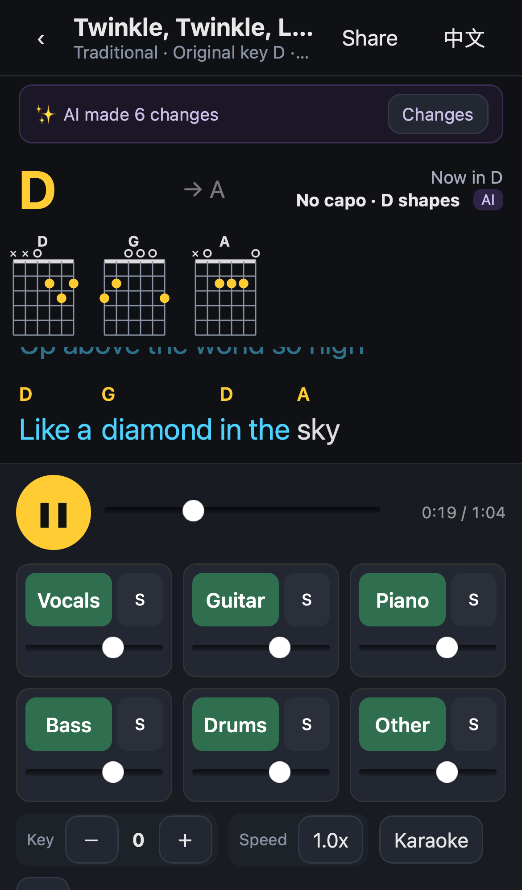
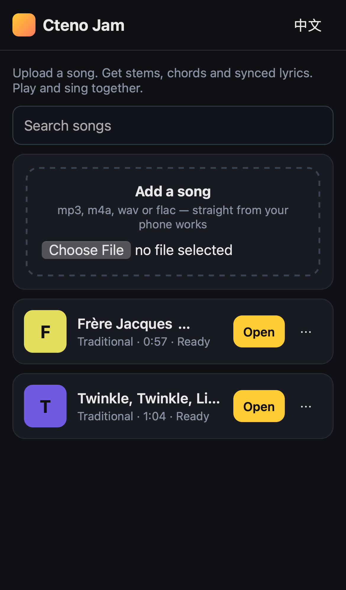
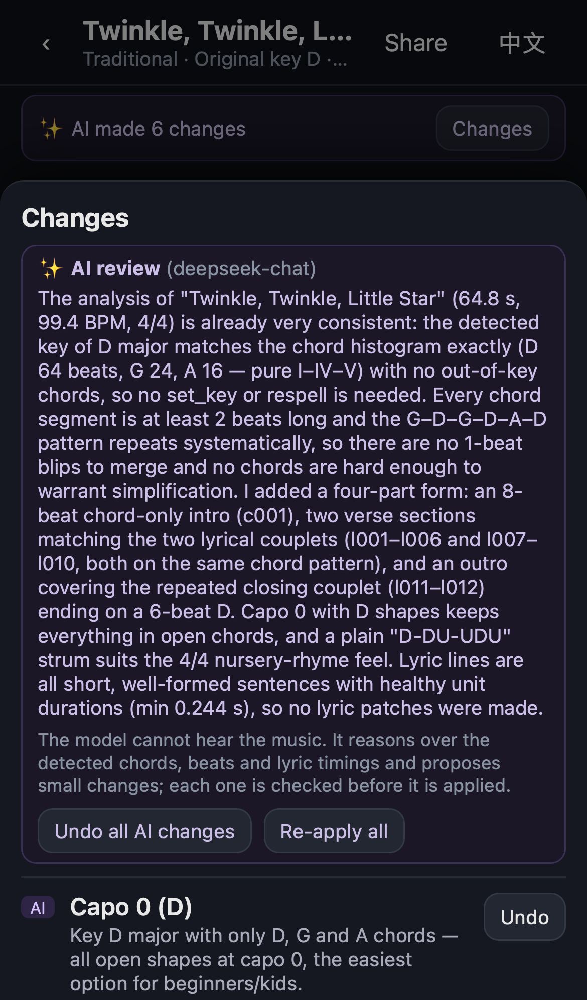
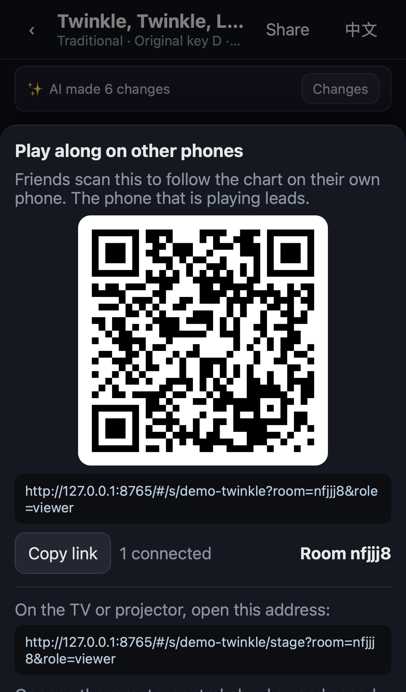
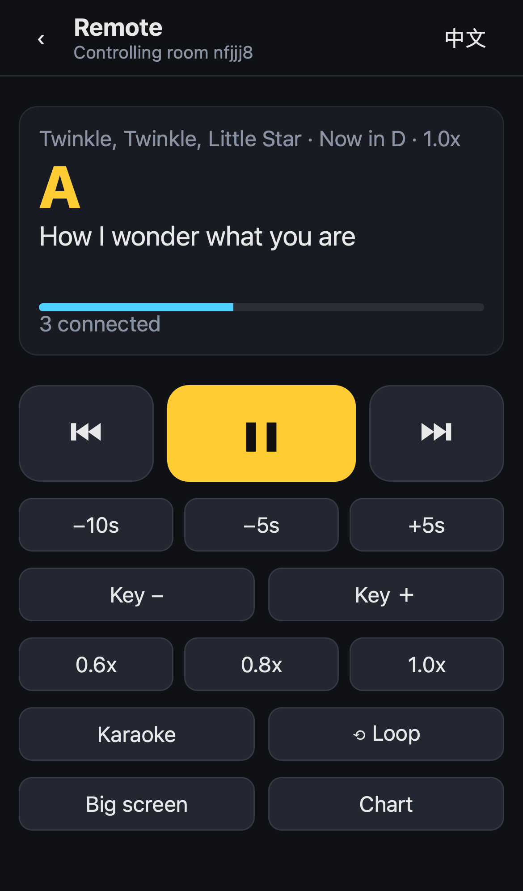
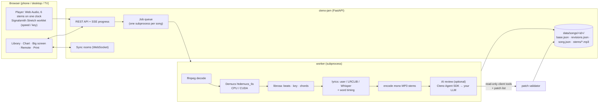

<p align="center"></p>

<h1 align="center">Cteno Jam</h1>

<p align="center">
<b>Upload a song. Get stems, chords, a guitar chart and synced lyrics. Play and sing along — together.</b><br>
<b>传一首歌，自动拆分轨、扒和弦、出吉他谱、对歌词，大家一起弹、一起唱。</b>
</p>

<p align="center"><a href="https://jam.cteno.cn"><b>Try it: jam.cteno.cn</b></a> · <a href="#english">English</a> · <a href="#中文">中文</a> · <a href="LICENSE">Apache-2.0</a></p>

> **Public instance / 公开实例: [jam.cteno.cn](https://jam.cteno.cn)** — upload your own song, no account
> needed. It runs on one GPU, so songs are processed one at a time in a queue (50 MB per file, 5 uploads per hour
> per visitor). Please only upload music you have the right to use.
> 不用注册，直接上传自己的歌。只有一张显卡，按排队一首一首处理（单个文件 50MB 以内，每人每小时 5 首）。请只上传你有权使用的音乐。

> **Cteno Jam is the first of a series.** We are building a set of open-source apps with
> Cteno's own AI to help people grow their hobbies and look after their personal growth.
> The idea: let AI do the hands-on production work, so people keep their time for interests,
> life, and growing in mind and body. ([What should we build next?](#next--征集下一款))
>
> **Cteno Jam 是一个系列的第一款。** 我们会用 Cteno 自己的 AI 能力，陆续做一批开源应用，帮人发展兴趣爱好、
> 照顾个人成长。立意是：让 AI 去干动手的生产型工作，人把时间留给兴趣、生活，以及精神和身体上的成长。

<p align="center">


</p>
<p align="center">




</p>

---

<a id="english"></a>

## What it does

For parties, karaoke nights, family evenings and kids' music time:

1. **Upload** any recording (mp3 / m4a / wav / flac / amr — from a phone's Files app or a WeChat chat is fine), **record** one right in the browser, or type in the library search box: with the optional **Jamendo** catalogue configured, the same search also finds Creative Commons tracks there (only tracks whose artists allow downloads; source and license are shown and kept) — tap one to use it. Every song shows its popularity (▶ 1.2万 / ▶ 12.3K) and lists are sorted most played first. It joins a queue; you see each stage and its progress, and the reason if it fails, with a retry button.
2. **Automatic processing**
   - six stems with [Demucs](https://github.com/facebookresearch/demucs) `htdemucs_6s`: vocals, guitar, piano, bass, drums, other
   - key, tempo, beats and downbeats; beat-synchronous chord recognition (chroma templates + bass + Viterbi smoothing)
   - lyrics: the text/LRC you paste → otherwise [LRCLIB](https://lrclib.net) synced lyrics → otherwise [faster-whisper](https://github.com/SYSTRAN/faster-whisper) transcription; then word-by-word (character-by-character for Chinese) timing on the vocal stem
   - **optional AI review** (below)
3. **Guitar chart**: chord diagrams, chords above the exact syllable, sections, recommended capo, "easy chords" for beginners and kids, strum pattern; print or save as PDF.
4. **Play and sing**: karaoke (vocals off), solo any stem, per-stem volume, speed 0.6–1.0× **without changing pitch**, transpose ±7 semitones **without changing speed**, A–B loop or loop a section, metronome and count-in, tap a word to jump.
5. **Together**: a **big-screen mode** for the TV/projector with huge lyrics and chords, a **phone remote**, and a **share link / QR code** so friends follow the same chart on their own phones in sync.
6. Fix anything by hand (chords, lyric text, timing). Every change — yours or the AI's — is listed with its reason and can be undone one by one or all at once.
7. English and Chinese UI, phone first, works on desktop too.

## AI review (optional) — powered by the Cteno Agent SDK

After stem separation and signal analysis, an LLM agent proofreads the result. It is an example
of the [Cteno Agent SDK](https://github.com/zalan159/cteno-sdk) (`pip install cteno-sdk`,
local mode, no Cteno account, bring your own model key):

- The agent gets **read-only client tools** that run in our server process (`get_overview`,
  `get_chords`, `get_lyrics`, `check_patches`) and must answer with a **structured list of
  patches** (`outputSchema`). It has no built-in tools and cannot touch files.
- Allowed patches: respell chords for the key (G#m, not Abm, in E major), merge 1–2-beat
  blips, label sections (intro/verse/chorus/bridge…), set capo + shape key, simplify chords for
  beginners, set a strum/arpeggio pattern, split/merge lyric lines, flag suspicious timing.
- **The server validates every patch** against the current data (e.g. a "respell" must sound
  identical, only short blips may be merged, sections may not overlap) and rejects the rest with
  a reason. The model never rewrites `song.json`. Accepted patches are stored as revisions next
  to the untouched base analysis, each with the model's one-sentence reason; the UI shows
  "what the AI changed and why" and undoes any of it.

> **Boundary: the model cannot hear the music.** It only reasons over numbers the DSP pipeline
> already produced (key, chords per beat, lyric timings). Recognition itself is done by Demucs,
> librosa and Whisper. The AI makes the chart consistent and friendlier; it does not "transcribe".

Turn it on with a key in `.env` (example uses DeepSeek):

```env
DEEPSEEK_API_KEY=        # your key; leave empty to skip AI review
JAM_AI_BASE_URL=https://api.deepseek.com/v1
JAM_AI_MODEL=deepseek-chat
```

Without a key everything else works and the chart shows "AI review can be enabled".
Real run on the demo songs: [`docs/evidence/ai-review/`](docs/evidence/ai-review/) (before/after diff and every reason).

## Quick start

```bash
git clone <this repo> cteno-jam && cd cteno-jam
cp .env.example .env          # optional
docker compose up -d          # CPU; first build downloads PyTorch + models
open http://localhost:8765
```

With an NVIDIA GPU ([nvidia-container-toolkit](https://docs.nvidia.com/datacenter/cloud-native/container-toolkit/) installed):

```bash
docker compose -f docker-compose.yml -f docker-compose.gpu.yml up -d
```

`JAM_DEVICE=auto` (default) uses the GPU when PyTorch can see one, otherwise the CPU.
Measured on the 65 s demo song (fresh container, [`docs/evidence/docker/`](docs/evidence/docker/)):
stem separation 9.4 s on CPU vs 3.0 s on an RTX 4000 Ada; separation scales with song length,
so a 4-minute song is roughly 35 s of separation on CPU and ~10 s on a GPU. The very first song
also downloads the Whisper model (~2 min); later songs reuse it from the `jam-models` volume.

**Player only** (no processing, any static host): `python scripts/build_demo.py static dist/static`
and serve `dist/static/` — it plays the bundled demo songs with every player feature
(sync needs a server: pass `--sync-url wss://your-jam-server`).

**Small public demo** (static player + sync rooms on a 1 GB VPS, ~65 MB RAM, no PyTorch):
`JAM_DEPLOY_SSH=root@host JAM_DEPLOY_DOMAIN=jam.example.com bash scripts/deploy_relay.sh`
installs the static build, a `JAM_MODE=player` sync service (systemd) and a Caddy site.
Processing needs a real machine: run the full Docker image at home or on a GPU box, and keep
the tiny VPS for the public player only. See [docs/deploy.md](docs/deploy.md).

**Without Docker** (Python 3.10+, ffmpeg on PATH):

```bash
pip install torch torchaudio --index-url https://download.pytorch.org/whl/cpu
pip install "./server[process,review]"
cteno-jam                      # http://localhost:8765
```

All settings are environment variables, documented in [`.env.example`](.env.example).
Optional: `JAM_JAMENDO_CLIENT_ID` (free id from devportal.jamendo.com) makes the library search also query Jamendo's Creative Commons catalogue through the server and mix the results in; without it the search stays local and nothing else changes.

Popularity: local songs count plays on the server (`POST /api/songs/{id}/play` when playback really starts or a jam starts; the same browser session within 30 s counts once; stored in `data/songs/.plays.json`). Jamendo results carry Jamendo's all-time listen counter and come in `order=popularity_total`. Mixed lists compare `plays × 1000` with Jamendo listens (one play here ≈ 1000 listens on Jamendo, whose audience is far larger), keep each source's own order, and let the local song win a tie; a Jamendo track already imported is shown once, as the library copy. See `web/js/popularity.js`.
For a public server set `JAM_PUBLIC_URL`, and either `JAM_ADMIN_KEY` (upload/edit passphrase) or the
open-upload guards `JAM_MAX_QUEUE`, `JAM_UPLOADS_PER_IP_HOUR` and `JAM_MAX_DISK_PERCENT` (what jam.cteno.cn uses;
put a reverse proxy in front that sets `X-Forwarded-For` and blocks delete/edit from the internet).

## Architecture



- `base.json` is the signal-level analysis and is never edited. `revisions.json` holds every AI
  or human patch (with reason and status). `song.json` = base + applied revisions, rebuilt on
  every change — that is what makes per-change undo trivial.
- The player decodes each stem to 32 kHz mono (≈170 MB for a 4-minute song instead of 512 MB)
  and starts all six on the same AudioContext time, so they stay sample-aligned. It sets
  `navigator.audioSession.type = "playback"` so iPhones play with the silent switch on.
- Sync: the playing device ("host") publishes `{position, at, rate, key, …}`; followers compute
  the live position from a server clock offset measured with pings. Remotes send commands to the host.

Code map: `server/cteno_jam/` (API, queue, worker, pipeline, `patches.py`, `review.py`),
`web/` (no build step, plain ES modules), `e2e/` (Playwright), `scripts/` (demo synthesis,
test runners), `docs/evidence/` (test logs, screenshots, recordings).

## Tests

```bash
cd server && python -m pytest          # unit + API tests; AI review against a fake model (offline)
node --test web/test/*.test.mjs        # chord theory / chart layout
scripts/e2e.sh <server-ip>             # Playwright: WebKit + Chromium, iPhone and desktop
zsh e2e/ios/run_sim_gui.sh <server-ip> demo-twinkle docs/evidence/ios   # real iOS Simulator Safari, with sound
```

The end-to-end test uploads a demo song and walks through processing, chart, playback (audio
level measured), stems, transpose, speed, loop, metronome, editing + undo, print, a second phone
following, big screen, remote control, rename and delete. The iOS run drives real Mobile Safari
in the Simulator through Web Inspector, records the Mac's system audio and checks each step is
loud or silent as expected. Results: [`docs/evidence/`](docs/evidence/README.md).

## FAQ

**Is it accurate?** On clean pop/folk recordings the key and tempo are usually right and chords
are mostly right at the triad level; jazz harmony, heavy distortion and rubato are hard. On the
bundled demos: key and tempo exact, ~90–95 % of time with the correct triad, median word-timing
error ~40 ms (with known lyrics). Always trust your ears; that is what the edit mode is for.

**Can I put copyrighted songs on a public server?** Don't. Run it for your own music at home or
for your group, set `JAM_ADMIN_KEY`, and don't share links to recordings you don't own.

**Does my audio leave my server?** No. Optional LRCLIB lookups send title/artist/duration; the
optional AI review sends the detected chords and lyric text to the model provider you choose. No audio.

**Why MP3 stems and not AAC/Opus?** Safari's `decodeAudioData` cannot read ffmpeg's m4a; mono
96 kbps MP3 decodes everywhere and keeps a 4-minute song at ~16 MB for all six stems.

**Speed/key buttons do nothing over plain http on a LAN IP.** Browsers only enable AudioWorklet
on https or localhost. Put the server behind https (any reverse proxy) or open it via localhost.

**The piano stem sounds smeared.** Upstream Demucs notes the 6-stem model's piano is the weakest stem.

**The first song is slow.** The first run downloads the separation model (~80 MB, baked into the
Docker image) and the Whisper model (~480 MB for `small`, only if no lyrics are found).

<a id="中文"></a>

## 中文说明

**适合**：朋友聚会、K 歌、家庭聚会、亲子音乐时间。

### 能做什么

1. **上传**：mp3 / m4a / wav / flac / amr，手机上可以从「文件」或微信聊天记录里选；也可以在网页里**直接录一段**，或者直接在曲库搜索框里搜：配置了 `JAM_JAMENDO_CLIENT_ID` 时，同一个搜索框也会搜 **Jamendo 免费曲库**，结果和本地曲库排在一起（只列作者允许下载的曲目，标出来源和许可证），点一下就能用；没配就只搜本地。每首歌显示热度（▶ 1.2万），列表按热度排序：本地歌按本站播放次数（真正开始播放或开合奏时 +1，同一会话 30 秒内只算一次），Jamendo 用它的累计收听数；混排时本地 1 次播放折算 1000 次 Jamendo 收听，分数高的在前，相同时本地在前。进入后台队列，能看到每一步和进度；失败会写明原因，可以重试。曲库支持搜索、改名、删除。
2. **自动处理**
   - 用 Demucs `htdemucs_6s` 拆成 6 轨：人声、吉他、钢琴、贝斯、鼓、其他
   - 调性、BPM、节拍和强拍；按拍识别和弦（色度模板 + 贝斯根音 + Viterbi 平滑）
   - 歌词：优先用你粘贴的歌词/LRC，没有就联网查 LRCLIB，还没有就用 Whisper 转写；然后在人声轨上逐字对齐
   - **可选的 AI 校对**（见下）
3. **吉他谱**：和弦图、和弦标在正在唱的那个字上方、段落、推荐变调夹、给新手和小朋友的「简化和弦」、扫弦节奏型；可以打印或存成 PDF。
4. **跟弹跟唱**：伴奏模式（去人声）、单独听某一轨、分轨音量、**变速不变调**（0.6–1.0 倍）、**移调不变速**（±7 个半音）、A-B 循环或循环某一段、节拍器和预备拍、点歌词跳转。
5. **一起玩**：**大屏模式**（电视或投影上显示大字歌词和和弦）、**手机当遥控器**、**分享链接和二维码**（朋友用自己的手机打开，同步看谱）。
6. 和弦、歌词、时间都可以手动修正。每一处修改（你改的、AI 改的）都列出理由，可以逐条撤销，也可以一键全部撤销。
7. 中英双语界面；手机优先，桌面也好用。

### AI 校对（可选）：用 Cteno Agent SDK 驱动

分轨和信号分析做完以后，由一个大模型 Agent 校对识别结果。这一步同时是 [Cteno Agent SDK](https://github.com/zalan159/cteno-sdk) 的示例：`pip install cteno-sdk`，本地模式，不需要 Cteno 账号，模型 key 自带（BYOK）。

- Agent 只能用我们在服务端进程里实现的**只读工具**（读概况、读和弦、读歌词、试校验 patch），最后用**结构化输出**交回一组 patch。它没有任何内置工具，碰不到文件。
- 能提的修改：按调性统一同音异名写法（E 调里写 G#m 而不是 Abm）、抹平只出现一两拍的误识别和弦、标注主歌/副歌/桥段等段落、推荐变调夹和指法调、给新手的简化和弦、扫弦或分解节奏型、歌词断句的拆分合并、标出可疑的对齐。
- **每条 patch 都由服务端校验**：比如「改写法」必须是同一个和弦、只有短毛刺才能合并、段落不能重叠。不合格的会被拒绝并写明原因。模型不能直接改写 `song.json`；通过的修改作为修订记录保存在原始分析之外，每条带一句理由，界面上能看到「AI 改了什么、为什么」，可以逐条或一键撤销。

> **边界：模型听不到声音。** 它只能根据已经分析出来的数据（调性、每拍的和弦、歌词时间）做推理和一致性修正。识别本身仍由 Demucs、librosa、Whisper 完成。AI 让谱子更一致、更好弹，但它不负责"听写"。

在 `.env` 里配 key 即可开启（示例用 DeepSeek）；不配 key，整条流程照常跑完，界面只提示「可以开启 AI 校对」。真实运行的前后对比和每条理由见 [`docs/evidence/ai-review/`](docs/evidence/ai-review/)。

### 快速开始

```bash
cp .env.example .env              # 可选
docker compose up -d              # CPU 版，打开 http://localhost:8765
# 有 NVIDIA 显卡：
docker compose -f docker-compose.yml -f docker-compose.gpu.yml up -d
```

有显卡时自动用 GPU。实测（65 秒的演示曲，全新容器）：分轨 CPU 9.4 秒、RTX 4000 Ada 3.0 秒；4 分钟的歌大约 CPU 35 秒、GPU 10 秒。第一首歌会额外下载 Whisper 模型（约 2 分钟），之后存在 `jam-models` 卷里复用。

只想要播放器：`python scripts/build_demo.py static dist/static`，把 `dist/static/` 放到任何静态服务器上即可，带两首演示曲。要在 1G 内存的小 VPS 上放公开演示（静态播放器 + 同步房间，不装 PyTorch，约 65MB 内存）：`scripts/deploy_relay.sh`。处理服务放在家里电脑或带 GPU 的机器上，部署方案见 [docs/deploy.md](docs/deploy.md)。所有配置项见 `.env.example`；对外开放时请设置 `JAM_ADMIN_KEY`（上传/修改口令）。

### 常见问题

- **准不准？** 干净的流行、民谣录音，调性和速度一般是对的，和弦在三和弦层面大部分是对的；爵士和声、重失真、自由节奏比较难。演示曲上：调性和速度全对，约 90–95% 的时间三和弦正确，已知歌词时逐字对齐的中位误差约 40 毫秒。以耳朵为准，不对就用「修正」改。
- **能把有版权的歌放到公网上吗？** 不要。请在家里或自己的小圈子里用，设置口令，不要把别人的录音分享出去。
- **音频会上传到别的地方吗？** 不会。可选的 LRCLIB 查歌词会发送歌名、歌手、时长；可选的 AI 校对会把识别出的和弦和歌词文本发给你配置的模型服务。不发送音频。
- **局域网 IP 打开时变速/移调没反应？** 浏览器只在 https 或 localhost 下开放 AudioWorklet。请用 https 反向代理，或通过 localhost 访问。
- **钢琴轨有点糊？** 上游 Demucs 也说明了 6 轨模型里钢琴轨效果最弱。

## Demo songs · 演示曲

Two public-domain children's songs, synthesised from scratch for this repo and released under
CC0 1.0: *Twinkle, Twinkle, Little Star* and *Frère Jacques*. No commercial recordings, lyrics or
stems are included. Details and credits: [THIRD_PARTY.md](THIRD_PARTY.md#demo-content).
仓库里只有两首公有领域童谣，是用程序从零合成的（CC0 1.0），没有任何商业录音、歌词或分轨。

## Next · 征集下一款

What hobby or growth app should the series build next — something where AI does the tedious
production work so you get more time for the part you love? Open an
[idea issue](../../issues/new?template=app-idea.yml) or start a thread in Discussions.

系列的下一款做什么？哪件你喜欢的事里，有一段繁琐的「生产型工作」可以交给 AI？欢迎开一个
[应用点子 issue](../../issues/new?template=app-idea.yml)，或在 Discussions 里聊聊。

## License

[Apache License 2.0](LICENSE) © The Cteno Jam contributors. Third-party components and models:
[THIRD_PARTY.md](THIRD_PARTY.md).
